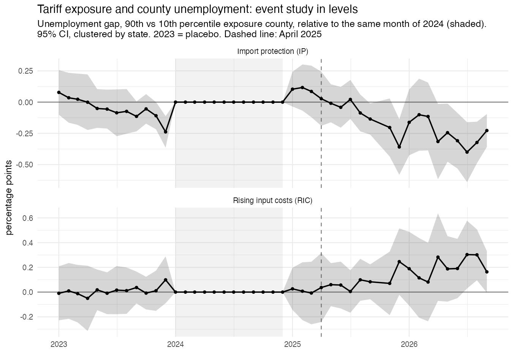

# Local labor-market effects of the 2025 U.S. tariffs

**Amir Azlan, University of Illinois Urbana-Champaign**

Did U.S. counties more exposed to the 2025 tariffs see their unemployment rates move
differently from less exposed counties? This project rebuilds the county tariff-exposure
measures of Azzimonti & Titcomb (2026) from raw customs records, then estimates a
month-by-month event study with the unemployment rate in levels, a formal pre-trend test,
and a power calculation. Their paper reports one static coefficient for 2025; this project
asks when any effect appears, and whether exposed counties were already on a different path.

## Findings

**Tariff exposure as a whole is not significantly associated with county unemployment in
2025 or 2026.** The two exposure measures, import protection (tariffs on what a county's
industries produce) and rising input costs (tariffs on what they buy), are correlated at
0.85 across counties. Estimated one at a time, neither is significant in any window. Over
January-September 2026, relative to the same months of 2024, the unemployment-rate gap
between a county at the 90th and one at the 10th percentile of exposure is -0.10
percentage points for import protection (s.e. 0.07) and -0.05 for input costs (s.e. 0.09).
The 95% confidence intervals, [-0.23, 0.03] and [-0.22, 0.12], rule out effects larger than
about a quarter of a percentage point between a 90th- and a 10th-percentile county, so this
is a fairly precise null rather than an uninformative one.

**Estimating both channels together gives a significant protection estimate for 2026, but
that split is fragile.** In the joint model, import protection is associated with lower
unemployment in 2026 (-0.24 percentage points, s.e. 0.11) and input costs have a positive,
insignificant estimate (+0.20, s.e. 0.12). The protection estimate holds when the most
exposed 1% of counties are dropped (-0.27, s.e. 0.13), when QCEW-suppressed employment is
imputed (-0.32, s.e. 0.15), and when exposure is measured through the October 2025 tariff
peak (-0.24, s.e. 0.10). For April-December 2025 it is -0.10 (s.e. 0.07) and not
significant. With exposures this correlated, the joint model separates the channels using
only the small share of variation in which they differ, so the single-channel estimates
above are the safer reading. The joint and single-channel estimates are consistent with
each other: the omitted-variable formula, applied with the two exposures correlated at 0.85,
approximately reproduces each single-channel estimate from the joint coefficients. The
pattern of opposite-signed coefficients that cancel when estimated separately is what the
two-channel theory predicts, and also what correlated regressors produce; these data cannot
tell the two apart.

Other caveats:

* **The strict pre-trend test fails for import protection.** The twelve 2023 placebo
  coefficients average close to zero (-0.05, s.e. 0.06, in the joint model) but are jointly
  significant, both in the joint model (p < 0.001) and with import protection alone
  (p = 0.014). For input costs alone it passes (p = 0.73). The specifications that pass the joint test, trimmed (p = 0.19)
  and suppression-imputed (p = 0.38), both keep a significant 2026 protection estimate.
  Import-protection exposure is heavily right-skewed (99th percentile 1.34 against 0.59 at
  the 90th), and dropping the top 1% of counties is one of the two changes under which the
  test passes.
* **Window averages, not timing.** The estimates average each window, so they show that the
  gap is larger in 2026 than in 2025, not the month it opened.
* **2026 mixes two things.** Exposure is the 2025 change, and realized tariff rates fell in
  early 2026, so the 2026 estimates combine lagged responses to 2025 with any response to
  that decline.

**Relation to Azzimonti & Titcomb.** Their static estimate for 2025 is significant (-0.24
on the 12-month log change of unemployment) and comes from a model with both channels
included. With the exposure measures built here, their specification gives nearly the same
t-statistics (-1.93 against their -2.0). In this event study, the joint 2025 estimate is
negative but not significant, the joint 2026 estimate is significant, and neither channel
is significant on its own. Because their estimate also separates two exposures correlated
at about this level, the same caution applies to it.

## Results



Each point is the unemployment-rate gap, in percentage points, between a county at the 90th
and one at the 10th percentile of tariff exposure, relative to the same calendar month of
2024. The 2023 points are placebos and should sit at zero. The top panel is the
import-protection channel (tariffs on what a county's industries produce); the bottom panel
is the input-cost channel (tariffs on what they buy).

* Numbers: [`output/results_summary.md`](output/results_summary.md) (window averages,
  standard errors, pre-trend tests, and seven alternative specifications).
* Raw data behind the regression: [`output/figures/main_fig_raw_groups.png`](output/figures/main_fig_raw_groups.png).
* Robustness: [`output/figures/main_fig_robustness.png`](output/figures/main_fig_robustness.png).

## What the pipeline does

| Step | Script | What it does |
|---|---|---|
| Download | `scripts/fetch_data.py` | Downloads the BLS QCEW county files and the LAUS county flat file. |
| Download | `scripts/fetch_missing.py` | Pulls HTS-10 x country x month imports (value, duties, quantity) from the Census trade API. Large chapters time out at the gateway, so a failed query is split into ten narrower commodity prefixes, recursively. |
| 1 | `scripts/01_build_concordance.py` | HTS-10 to NAICS-6 to NAICS-3 to BEA Summary industry, from four vintages of the Census import concordance, with a prefix fallback for unmatched codes and a QA report. |
| 2 | `scripts/02_build_trade_panel.py` | Monthly product-country panel. Drops the regional and bloc aggregate rows the API returns alongside countries, and verifies for every product-month that country rows sum to the reported total. |
| 3 | `scripts/03_build_qcew_county.py` | County x industry employment from 3,143 QCEW county files, treating suppressed cells as missing. |
| 4 | `scripts/04_convert_laus.py` | County unemployment rates from the LAUS flat file. |
| 5 | `scripts/05_exposure_and_estimation.Rmd` | Industry realized tariffs with fixed 2024 weights; Import Protection and Rising Input Cost exposure from the BEA use table; county exposure from 2024 employment shares. |
| 8 | `scripts/08_event_study_levels.Rmd` | **Main results.** Fixed 2025 county exposure x calendar month, unemployment rate in levels. |

`06` and `07` are described under "How the specification was chosen."

## Validation

The exposure measures are only as good as the data work under them, so each stage is
checked against something external.

* **Concordance.** Every HTS-10 code in the customs data matched the Census concordance
  exactly (19,408 codes, 2024-2026). 4.2% of import value sits in special-provision
  chapters 98-99 and 0.8% under placeholder NAICS codes; both are excluded from industry
  aggregates and reported.
* **Customs panel.** Country rows reproduce the reported all-country total in every one of
  487,256 product-months (2024-March 2026), for both value and duties.
* **Realized tariff rates** against the paper:

  | | This project | Azzimonti & Titcomb |
  |---|---|---|
  | All imports, May 2025 | 8.96% | 8.7-8.9% |
  | All imports, October 2025 | 10.82% | about 11% |
  | All imports, December 2025 | 9.20% | 9.3% |
  | China, December 2025 | 28.96% | 29.2% |

* **Industry tariffs.** 2024 averages match their Table 2 closely (fabricated metals 5.97
  vs 5.87; plastics and rubber 4.90 vs 4.85). 2025 averages run higher here. The likely
  reason is that this project holds 2024 import weights fixed, so exposure does not fall
  when importers substitute away from tariffed goods; the paper's weighting is not fully
  documented, so this is not confirmed.
* **Their regression.** Running their static specification on these exposure measures gives
  t-statistics of -1.93 (import protection) and 0.96 (input costs) against their -2.0 and
  0.92.
* **Known gap.** The *level* of county exposure here is well below the scale of their
  Figure 12. The regression replication above suggests the measures carry the same
  information; the difference in scale is unresolved and is noted wherever it matters.

## How the specification was chosen

The first two specifications were set aside, and the reasons are part of the result.

1. **Distributed lag with cumulated coefficients** (`05`, robustness in `06`). Regressed
   unemployment on thirteen leads and lags of the monthly change in exposure and summed the
   coefficients. Estimates were insignificant with very wide bands.
2. **Diagnosis** (`07`). Summing coefficients gives the effect of a permanent increase only
   when the regressor is a level. With a monthly-change regressor, the sum describes
   exposure rising every month forever, and its variance grows with every term added.
3. **Local projections** (`07`). One regression per horizon. Placebo horizons were clean
   once the lagged-outcome controls were stopped from spanning the dependent variable. But a
   positive control failed: the share of an injected effect that the design recovered fell
   from 97% to 48% when six months of outcome data were added. The most likely reason is
   that monthly tariff changes are serially correlated, so each horizon coefficient also
   picks up the shocks that follow within its window.
4. **Fixed exposure x calendar month** (`08`). The 2025 tariffs reached every county in the
   same months; counties differ in dose and not in timing. Event-time lag designs ask for
   timing variation the data does not have. Holding exposure fixed and letting its
   coefficient vary by month uses the variation that exists, gives a direct pre-trend test
   on 2023, and recovers injected effects of 0.1 and 0.5 exactly in the positive control
   (`08`, section 4.3).

## Reproducing

Raw data are not in the repository (several thousand files). To rebuild:

```bash
# Python 3.10+, R 4.3+
pip install pandas requests python-dotenv pyarrow
Rscript -e 'install.packages(c("data.table","arrow","fixest","ggplot2","scales","rmarkdown"))'

echo 'CENSUS_API_KEY=your_key' > .env          # free key: api.census.gov/data/key_signup.html
python3 scripts/fetch_data.py                  # QCEW 2024 county files + LAUS county file
python3 scripts/fetch_missing.py               # customs data; many hours
# add by hand under data/raw/: concordance/impconcordYY.csv (Census import concordance)
#                              "2024 BEA Table.csv" (BEA Summary use table)
python3 scripts/01_build_concordance.py
python3 scripts/02_build_trade_panel.py
python3 scripts/03_build_qcew_county.py --years 2024
python3 scripts/04_convert_laus.py --input data/raw/laus/la_data_county.txt
Rscript -e 'for (f in c("05_exposure_and_estimation","06_robustness","07_diagnostics_and_lp","08_event_study_levels")) rmarkdown::render(sprintf("scripts/%s.Rmd", f))'
```

Rendered reports (`scripts/*.html`) are committed; download one to read it with its figures.

## Data sources

* U.S. Census Bureau, International Trade API: monthly imports by HTS-10 and country,
  January 2023 to March 2026; import concordance files (HTS-10 to NAICS).
* Bureau of Labor Statistics: Quarterly Census of Employment and Wages (county x industry
  employment, 2024); Local Area Unemployment Statistics (county unemployment rates).
* Bureau of Economic Analysis: Use of Commodities by Industries, Summary level, 2024.

## Limitations

* Identification rests on county industry mix. Anything else that affected
  manufacturing-heavy counties differently in 2025-26 than in 2024 is attributed to tariffs.
* Realized tariffs reflect importer behaviour (front-loading, sourcing shifts, exemptions).
* State-clustered standard errors do not address correlation among counties with similar
  industry mixes.
* QCEW suppresses about half of NAICS-3 manufacturing employment in the median county.
* LAUS county estimates are model-based; October 2025 is missing and 2026 is preliminary.
* Retaliation on U.S. exports and general-equilibrium effects are not measured.

## References

* Azzimonti, M. and J. Titcomb (2026). "U.S. Import Tariffs in 2025: Realized Tariff Rates,
  Import Prices, and Local Labor-Market Effects." Federal Reserve Bank of Richmond Working
  Paper 26-08.
* Flaaen, A. and J. Pierce. "Disentangling the Effects of the 2018-2019 Tariffs on a
  Globally Connected U.S. Manufacturing Sector."
* Schmidheiny, K. and S. Siegloch (2023). "On Event Studies and Distributed-Lags in Two-Way
  Fixed Effects Models." *Journal of Applied Econometrics*.
* Adao, R., M. Kolesar and E. Morales (2019). "Shift-Share Designs: Theory and Inference."
  *Quarterly Journal of Economics*.

Further notes: [`docs/tariff_paper_outline.md`](docs/tariff_paper_outline.md),
[`docs/concordance_strategy.md`](docs/concordance_strategy.md).
